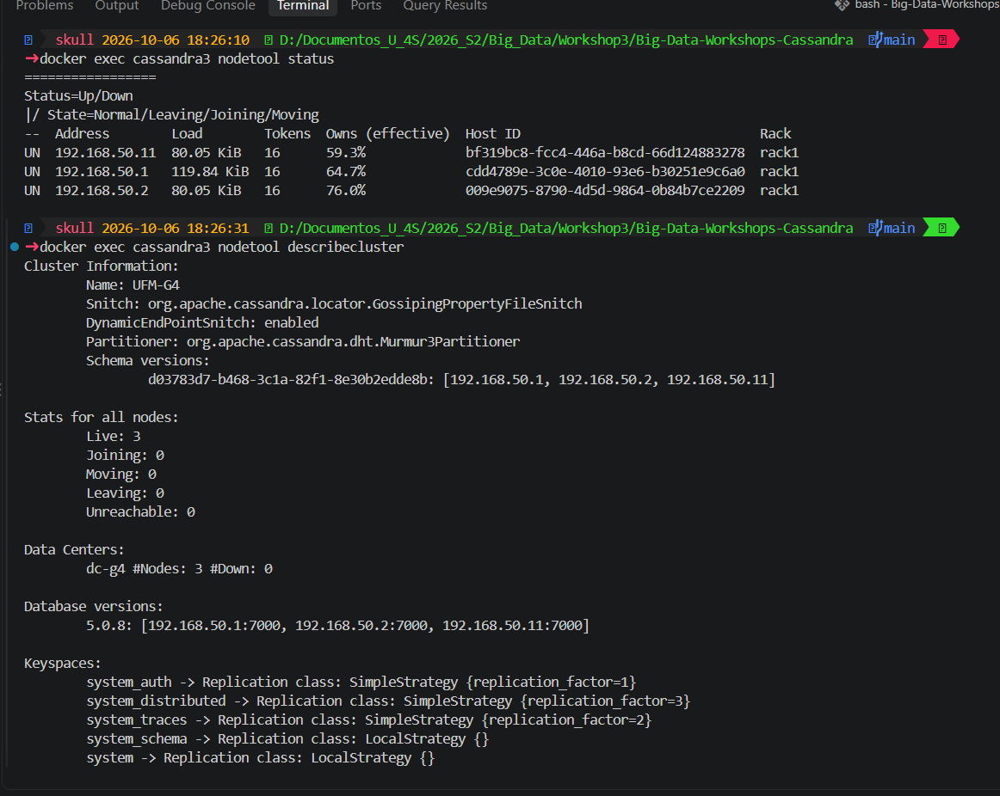
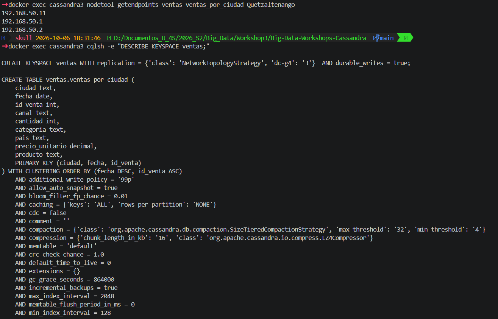
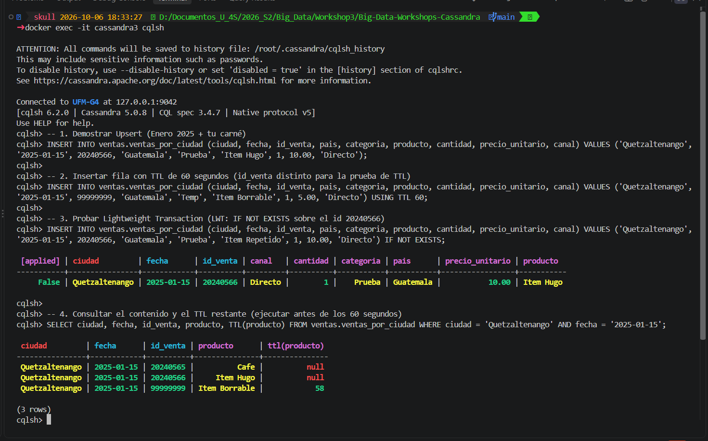
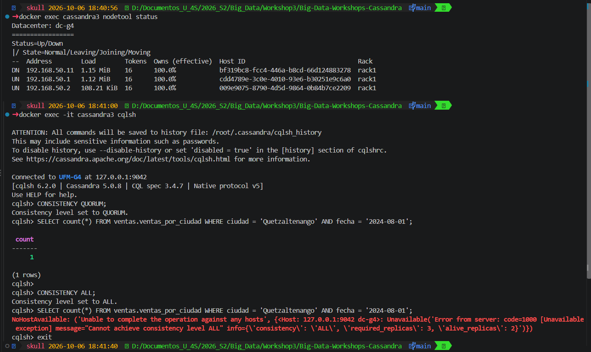
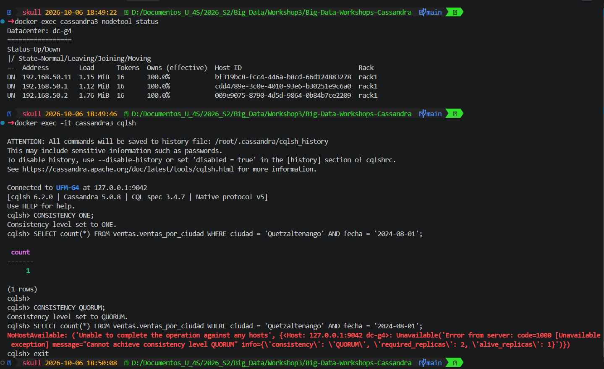
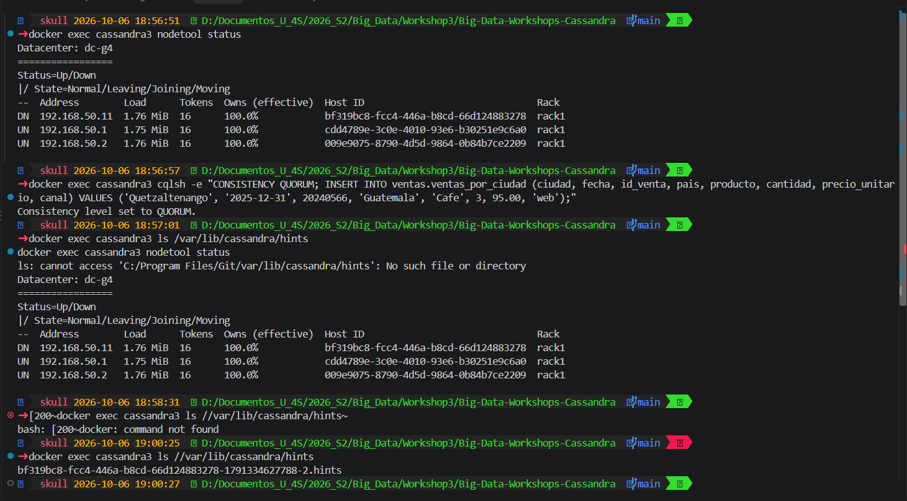
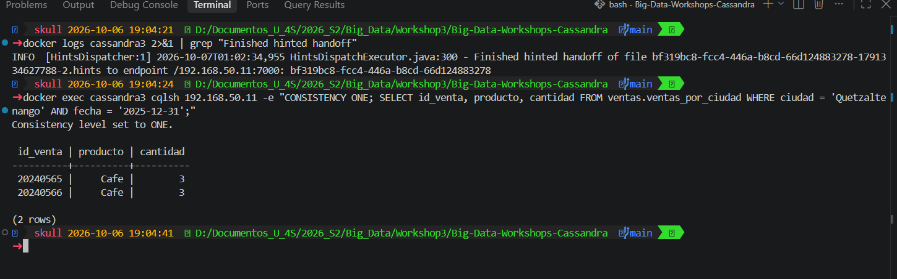

# Bitácora del taller de Cassandra

- **Nombre: Hugo Jonathan Daniel Galina Puac**
- **Carné: 20240566**
- **Grupo: G4**
- **Tu nodo en el clúster del grupo: 3**

---

## 1. Evidencias

### E1. Tres nodos en tu clúster y tu datacenter

Se observa el estado del clúster UFM-G4 con sus tres nodos activos en estado UN (192.168.50.1, .2 y .11) en el datacenter dc-g4.

### E2. Las copias de la partición de Quetzaltenango

Muestra los tres endpoints donde reside la partición de Quetzaltenango (192.168.50.11, .1 y .2) y la definición del keyspace ventas con Replication Factor de 3 en dc-g4.

### E3. Upsert, TTL e IF NOT EXISTS

Se visualiza la inserción/actualización con upsert del carné 20240566, la validación de LWT retornando [applied] False ante una colisión y el conteo regresivo del TTL en 58 segundos.

### E4. Un nodo caído: QUORUM frente a ALL

Con el nodo 192.168.50.11 en estado DN, la lectura con nivel de consistencia QUORUM responde exitosamente, mientras que con ALL falla arrojando NoHostAvailable / UnavailableException.

### E5. Dos nodos caídos: ONE frente a QUORUM

Con dos nodos en estado DN, la lectura configurada en consistencia ONE logra responder al único nodo vivo, mientras que QUORUM es rechazada al no alcanzar la mayoría requerida de 2 réplicas.

### E6a. El hint guardado para el nodo caído

Se confirma la generación del archivo .hints correspondiente al Host ID bf319bc8-fcc4-446a-b8cd-66d124883278 mientras el nodo 192.168.50.11 se encontraba fuera de línea.

### E6b. La entrega del hint

Muestra en el log la ejecución exitosa del Finished hinted handoff hacia el endpoint /192.168.50.11:7000 y la posterior lectura de la venta escrita en dicho nodo recién recuperado.

### Tabla del Paso 8

| Nodos caídos | `ONE` | `QUORUM` | `ALL` |
|---|---|---|---|
| 0 | ✅ | ✅ | ✅ |
| 1 | ✅ | ✅ | ❌ |
| 2 | ✅ | ❌ | ❌ |

---

## 2. Preguntas

**1. ¿Qué línea de la traza muestra que la consulta por ciudad leyó una sola partición, y cuál que la de producto recorrió toda la tabla? ¿Por qué Cassandra rechaza la segunda sin ALLOW FILTERING?**

La traza de la consulta por ciudad muestra la línea `Executing single-partition query on ventas_por_ciudad`, lo que indica que Cassandra usó la partition key directamente para ir a un solo nodo/partición. Por el contrario, la consulta por producto muestra `Scanned 33 rows` e inspeccionó todas las particiones del clúster. Cassandra rechaza esta última sin `ALLOW FILTERING` porque carece de `ciudad` (partition key) en la cláusula `WHERE`, lo que obligaría a realizar un escaneo completo (full table scan) extremadamente ineficiente que degrada el rendimiento del clúster distribuido.

**2. ¿Qué lecturas se comportaron como CP y cuáles como AP? ¿Qué nivel usarías para el saldo de una cuenta y cuál para un contador de reproducciones, y por qué?**

Las lecturas con niveles de consistencia `QUORUM` y `ALL` se comportaron como CP (Consistency/Partition tolerance), ya que prefirieron rechazar la operación (arrojando `UnavailableException`) antes que responder con datos potencialmente desactualizados cuando faltaban réplicas disponibles. La lectura con `ONE` actuó como AP (Availability/Partition tolerance), priorizando la disponibilidad al responder con el único nodo vivo disponible. Para el saldo de una cuenta bancaria usaría `QUORUM` o `LOCAL_QUORUM` para garantizar consistencia fuerte y evitar lecturas inconsistentes de dinero. Para un contador de reproducciones utilizaría `ONE` (o un tipo especial `COUNTER`), donde la alta disponibilidad y baja latencia son prioritarias sobre la precisión exacta e inmediata de cada conteo.

**3. ¿Cómo se enteró el nodo apagado de tu venta? ¿Qué pasaría si el nodo estuviera apagado más tiempo que max_hint_window?**

El nodo apagado se enteró gracias al mecanismo de Hinted Handoff: mientras el nodo con Host ID `bf319bc8-fcc4-446a-b8cd-66d124883278` estuvo caído, el coordinador guardó la mutación en un archivo `.hints` local. Al volver el nodo a estado `UN`, el coordinador retransmitió los datos pendientes mostrando en el registro la línea `Finished hinted handoff of file bf319bc8-fcc4-446a-b8cd-66d124883278-... to endpoint /192.168.50.11:7000`. Si el nodo permaneciera apagado por un tiempo superior a `max_hint_window` (por defecto 3 horas), el coordinador dejaría de almacenar nuevos hints para él; al reincorporarse, el nodo quedaría desincronizado y requeriría una reparación manual o programada mediante `nodetool repair` (o Read Repair) para recuperar la consistencia de los datos.

---

## 3. Mini-reto

### Tablas

| Tabla | Consulta que responde | Partition key | Clustering key |
|---|---|---|---|
| `c1_ficha_sensor` | C1 | `sensor_id` | N/A |
| `c2_lectura_reciente` | C2 | `sensor_id` | `leida_en` |
| `c3_alertas_sitio` | C3 | `sitio_id` | `generada_en`, `alerta_id` |
| `c4_metricas_sensor` | C4 | `sensor_id` | `leida_en` |

### Justificación

**Por qué esas llaves:**
- En `c1_ficha_sensor`, `sensor_id` es la Partition Key para obtener la ficha técnica de un sensor específico directamente en una partición en O(1).
- En `c2_lectura_reciente`, `sensor_id` es la Partition Key para agrupar todas las lecturas de un dispositivo, y `leida_en` como Clustering Key en orden descendente permite recuperar la lectura más reciente de forma instantánea usando `LIMIT 1`.
- En `c3_alertas_sitio`, `sitio_id` es la Partition Key para consultar las alertas de un sitio, mientras que `generada_en` (DESC) y `alerta_id` (ASC) como Clustering Keys permiten ordenar las alertas cronológicamente e impedir colisiones entre registros generados al mismo tiempo.
- En `c4_metricas_sensor`, `sensor_id` es la Partition Key y `leida_en` la Clustering Key, lo que permite realizar filtrados eficientes por rangos de tiempo (`>=` y `<`) y calcular agregaciones (`COUNT`, `MAX`) sobre la partición del sensor sin necesidad de `ALLOW FILTERING`.

**Qué datos quedaron duplicados entre tablas:**
Quedaron duplicados los valores de `valor` entre las tablas de lecturas (`c2_lectura_reciente` y `c4_metricas_sensor`), así como el `tipo` de sensor y la relación del sensor con su `sitio_id` desnormalizados dentro de `c3_alertas_sitio` para evitar operaciones de `JOIN`.

**Qué hace la aplicación si cambia un dato duplicado:**
Dado que Cassandra no soporta transacciones relacionales complejas ni llaves foráneas automáticas, si un dato desnormalizado cambia (por ejemplo, la reclasificación del `tipo` de un sensor), la aplicación cliente es responsable de actualizar en batch (`LOGGED BATCH`) o actualizar secuencialmente todas las tablas donde dicho dato se encuentre duplicado (`c1_ficha_sensor` y `c3_alertas_sitio`) para mantener la consistencia entre las vistas.

---

## 4. Problemas encontrados (opcional)

Durante la ejecución del taller se presentó un timeout con `cqlsh` al momento de crear el esquema del mini-reto en los 3 nodos; se resolvió añadiendo el parámetro `--request-timeout=60` al comando de ejecución. Asimismo, para asegurar la captura del Hinted Handoff, se configuró correctamente la ruta de almacenamiento de los archivos `.hints` dentro del contenedor.